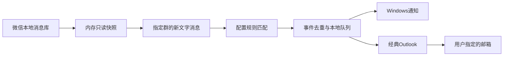

# 群聊自动监控与通知 · 基于摘星

把群聊里你指定的信息筛选出来，自动通知你。

这是基于 [摘星（wx-assist）](https://github.com/MaleleStudySpace/wx-assist) 的 Windows 本地监控扩展：增量读取一个明确授权的微信群，按你配置的关键词规则筛选消息，去重后通过 Windows 通知和经典 Outlook 邮件提醒。适合持续关注特价、学校通知、团队事项等场景，规则不绑定某种商品或业务。

**部署方式：直接把 [agent 部署指南](docs/AGENT_DEPLOYMENT.md) 发给agent，或使用其中的任务模板。** 指南包含需要向用户确认的信息、安装命令、配置格式、验收标准、停止条件和故障处理。

## 用户需要提供什么

先把“看哪个群、看什么、怎么通知”告诉 agent，再配合完成本机登录和读取授权即可。

| 用户提供或确认 | 怎么说清楚 |
| --- | --- |
| 可操作的 Windows 电脑 | 让 agent 能访问目标电脑；微信已登录，或由你在本机完成登录 |
| 唯一目标群 | 提供完整群名；有同名群时说明具体是哪一个 |
| 筛选条件 | 关注的关键词、排除词，或品牌／规格／价格等明确条件；数字条件写清 `<` 还是 `≤` |
| 通知去向 | 提供唯一收件邮箱；邮件通过本机经典 Outlook 发出，选择一个发件账户并自行登录 |
| 运行偏好 | 是否持续监控，是否把监控、微信和 Outlook 设置为 Windows 登录后启动 |
| 本地读取准备 | 已有授权配置时提供其本地文件路径；尚未准备时，配合 agent 说明的本机授权步骤，密钥只保存在本地 |

Python 版本、程序安装路径、部署目录和群内部 ID 等技术信息，可由 agent 在获授权后检查；不必先让用户手动找齐。无法确定唯一群或缺少本地读取条件时，agent 再说明具体缺口。

## 示例：补剂群优惠发到邮箱

下面改写自本项目的一次部署，群名、账户和地址已替换。用户可以直接这样描述：

```text
请在我已连接的 Windows 电脑上部署这个项目，只看 <补剂优惠群的完整群名> 一个群。
符合以下任一条件时提醒我：
1. ON 蛋白粉，单件 5 磅，明确的人民币报价严格小于 580 元。
2. 熊猫蛋白粉，单件 5 磅，明确的人民币报价严格小于 400 元。
3. ON 蛋白粉，单件 5.64 磅，明确的人民币报价严格小于 600 元。
4. 消息出现“超好价”“超好忦”或群里对应的已支持写法，也提醒我；这条不限品牌和价格。
价格或规格不清楚时，不要当作确定符合价格条件。

邮件发到 <我的收件邮箱>，使用经典 Outlook 中的 <发件邮箱> 发信。
先发一封明确标注的合成测试邮件，确认收到后，持续监控后续新消息。
把监控、微信和 Outlook 设置为当前用户登录后启动。
微信登录和本地读取授权我会配合完成，其余环境检查、配置和测试交给 agent。
不向群里回复，不购买，不上传私有配置或群聊天记录。
```

agent 会把这一组复合条件对应到已有的 `protein_deals` 示例适配器；学校通知等纯关键词场景使用 `generic`。完整的输入分工、配置示例、命中／不命中边界和验收结果见[这个案例](docs/EXAMPLES.md#supplement-alert-example)。

## 可以用来做什么

| 场景 | 规则示例 | 提醒用途 |
| --- | --- | --- |
| 特价群跟踪 | “限时优惠”“补货”“超好价”，排除“售罄” | 关注商品优惠和补货信息 |
| 学校群通知 | “考试安排”“报名截止”“提交材料”“停课通知” | 提醒回到原群查看重要通知 |
| 团队与项目群 | “会议改期”“提交周报”“发布窗口” | 跟进需要处理的事项 |
| 社区与活动群 | “停水通知”“报名开始”“活动变更” | 筛选日常通知与活动变动 |

## 已实现的能力

- **通用规则配置**：任一关键词命中即可提醒；支持排除词、规则启停及优先顺序，不需要改 Python 代码。
- **本地增量读取**：正常每 15 秒检查新消息，记录处理位置；首次运行建立基线，不回扫历史消息。
- **去重与恢复**：相同事件在 72 小时内合并；游标、事件和通知队列持久化，支持脚本重启后恢复。
- **通知**：Windows 托盘通知；通过已有经典 Outlook 账户向配置的一个邮箱发送命中片段。
- **邮件故障处理**：Outlook 关闭时按需打开；明确未发送的临时故障可重试，发送结果不确定时暂停队列，避免重复。
- **agent 部署材料**：本地配置模板、规则预览、合成测试、登录启动脚本、验收清单和故障说明。

当前每个实例处理**一个明确配置的群**，只处理文字消息。多群管理、OCR、语音识别、语义分类、Webhook、SMTP 和手机推送不是这个监控扩展已实现的功能。现有商品价格解析保留为[可选示例适配器](docs/EXAMPLES.md)，默认不启用。

## 快速开始

```powershell
git clone --branch group-chat-monitor --single-branch https://github.com/YangBiao91/wx-assist.git
cd wx-assist
```

然后选择阅读：

- [手动安装、配置与运行](monitor/README.md)
- [让另一个 agent 自主部署](docs/AGENT_DEPLOYMENT.md)
- [场景规则示例与扩展方式](docs/EXAMPLES.md)
- [测试范围与证据](monitor/TESTING.md)

本监控的锁文件和 CI 使用 **Windows x64 + CPython 3.12**。邮件场景需要已经登录的**经典 Outlook**，不是新版 Outlook。微信数据库目录、唯一群 ID 和已有的授权数据库密钥需要在本地准备；仓库不包含密钥提取器的部署流程，也不能在缺少这些前提时宣称“部署完成”。

## 工作方式



`generic_rules.py` 负责通用关键词规则，`matcher.py` 选择规则配置；`monitor.py` 负责群范围校验和读取循环；`state.py` 保存进度和事件；`email_queue.py`、`outlook_mailer.py`、`outlook_session.py` 负责邮件排队、发送校验及 Outlook 恢复；`startup.py` 负责 Windows 登录启动。

规则文本只作为数据处理，不执行群消息里的代码或命令。通知只发送当前配置范围内的命中片段，不从群消息中决定收件人，不自动回复群聊或执行购买等操作。

## 数据与运行边界

微信消息库的解密快照只在内存中处理；命中片段、事件哈希和队列保存在本机。本地配置、密钥、消息数据和实发测试报告被 `.gitignore` 排除，不能上传到 GitHub。**数据库密钥属于数据库级权限，单群限制由监控代码实施，不是微信提供的单群授权。**

电脑需保持运行并处于可用的 Windows 用户会话，微信需要同步本地数据。休眠、关机、密钥失效、数据库结构变化、邮箱登录失效、网络中断或收件箱过滤都可能影响提醒。登录和安全提示由用户处理，程序不改变安全设置。

## 来源与许可证

本仓库是 [MaleleStudySpace/wx-assist](https://github.com/MaleleStudySpace/wx-assist) 的 fork。监控扩展基于上游 **v1.9.0**（`5d4b2a0d3b2911e06a717f7aafc2daa19e5bb639`），保留 Git 历史、作者署名和 [MIT License](LICENSE)；原项目说明在 [README.upstream.md](README.upstream.md)。

监控入口不会启动上游桌面 UI、Bot、AI、RAG、HTTP 服务或密钥提取组件。上游代码的改动仅涉及监控必需的内存只读数据库处理；上游完整应用的其他入口仍保留原有行为。此扩展不捆绑发布包内未公开源码的 DLL、WASM 或 EXE。
