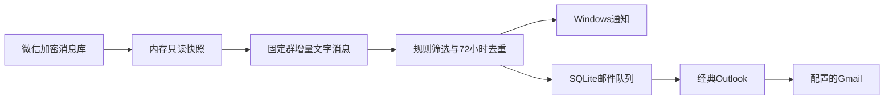

# 单群蛋白粉优惠监控

在 Windows 本地读取一个明确配置的微信群文字消息，以固定规则筛选、去重，再显示托盘通知和通过经典 Outlook 发送邮件。入口是本目录的 `control.py`；不会启动上游的桌面应用、Bot、AI、RAG 或 HTTP 服务。

## 功能和规则

| 类型 | 条件 |
| --- | --- |
| ON 价格 | 单件明确 5 磅，人民币报价严格小于 580 元 |
| 熊猫价格 | 单件明确 5 磅，人民币报价严格小于 400 元 |
| 关键词 | 出现“超好价”“超好忦”（U+5FE6）“超好價”或“超好讠介／超好言介”等已实现写法 |

关键词提醒独立于品牌、规格、价格，只表示提到该词。价格条件不明确时留在本地待核；等于 580／400 元不触发对应价格规则。没有诺特兰德／362 元产品规则。仅识别文字，不做图片 OCR、语音识别或商品网页抓取。

## 环境与安装

需要 Windows、Python 3.13、已登录的微信桌面端、已登录发件账户的**经典 Outlook**。本地开发环境曾在微信 4.1.15.13、经典 Outlook 16.0.17932.21056 上验证；其他版本未承诺兼容。仅此监控不需要安装上游全部 AI、前端和打包依赖。

从仓库根目录执行：

```powershell
py -3.13 -m venv .venv
.\.venv\Scripts\python.exe -m pip install --require-hashes -r monitor\requirements.lock
Copy-Item monitor\settings.example.json monitor\settings.local.json
Copy-Item monitor\credentials.example.env monitor\credentials.local.env
```

只在本地编辑两份副本：

- `settings.local.json`：唯一群的内部 ID（以 `@chatroom` 结尾）、发件邮箱、唯一收件邮箱、经典 Outlook 的绝对安装路径。邮箱示例不可直接使用。
- `credentials.local.env`：此前已授权获得的 `WCDB_KEY` 和本机微信账户目录 `DB_PATH`。本监控不负责提取密钥，不包含闭源 DLL／WASM／打包程序。密钥在本地文件中为明文，属于数据库级权限；单群限制由监控代码实施。

初始化配置并先做本地读取：

```powershell
.\.venv\Scripts\python.exe -B monitor\configure.py init
.\.venv\Scripts\python.exe -B monitor\monitor.py --read-once
```

第一次初始化只建立消息游标，不回扫旧消息。`--read-once` 不发邮件或通知，但会更新本地进度。更换群或邮箱需要停止脚本并重新核对配置；启动时固定配置，运行中逐轮校验群范围。初始化不会覆盖已有配置。

## 邮件验证与启用

默认邮件关闭。手动生成一个新的 32 位十六进制测试 ID；下面 `<TEST_ID>` 必须替换为同一个实际 ID：

```powershell
.\.venv\Scripts\python.exe -c "import uuid; print(uuid.uuid4().hex)"
.\.venv\Scripts\python.exe -B monitor\outlook_mailer.py --test-id <TEST_ID>
.\.venv\Scripts\python.exe -B monitor\outlook_mailer.py --test-id <TEST_ID> --submit
```

第一条 mailer 命令只预览；加 `--submit` 才发送一封明确标注的测试邮件。请在目标 Gmail 收件箱或垃圾邮件中确认收到，然后显式启用未来提醒：

```powershell
.\.venv\Scripts\python.exe -B monitor\configure.py enable-email --test-id <TEST_ID> --confirm-gmail-received
.\.venv\Scripts\python.exe -B monitor\control.py start
```

没有 SMTP 密码或新 OAuth 凭据。Outlook 使用现有登录，会在需要发信时按需启动。遇到登录／安全提示由用户处理，程序不会自动点击或改变安全设置。只发配置的一个收件人，不加附件、抄送或密送。群消息只保留必要命中摘要，不发送整个聊天记录。

## 日常使用和登录自启

`Start.cmd`、`Stop.cmd`、`Status.cmd` 分别启动、停止、查看状态。托盘菜单可暂停、恢复、退出。`monitor/data/offers.html` 显示本地候选；`status.json` 中的 `last_success` 是最近成功轮次。

正常每 15 秒读取，暂时读取失败每 30 秒重试。明确未发送的临时邮箱故障每 5 分钟重试；不确定是否已发送时暂停邮件队列，避免重复。首次登录启动最多尝试 6 次；用户后续主动退出监控不会被该启动器强制拉回。

先预览当前用户登录启动项，再按需加 `-Apply`：

```powershell
.\monitor\configure_monitor_startup.ps1
.\monitor\configure_monitor_startup.ps1 -Apply
.\monitor\configure_app_startup.ps1 -OutlookExe 'C:\Program Files\Microsoft Office\Root\Office16\OUTLOOK.EXE' -WeixinExe 'C:\REPLACE_WITH_YOUR_PATH\Weixin.exe'
```

最后一条同样加 `-Apply` 才写入微信和 Outlook 的启动快捷方式。只操作当前用户 Startup 文件夹，遇到同名无关项停止，不修改安全设置，不安装服务或重启电脑。快捷方式绑定此仓库及 `.venv` 路径，移动后需重新配置。微信可能仍需手机确认登录。

## 测试

```powershell
.\.venv\Scripts\python.exe -B -m unittest discover -s monitor -p 'test_*.py' -v
```

合成单元测试不读取真实微信、不发送邮件。开发时已验证边界价格、关键词特殊字、事务回滚、游标恢复、队列去重、Outlook 关闭后的恢复及登录启动条件。发布副本另验证配置脱敏与未配置时拒绝运行。

`future_delivery_e2e.py prepare` 只创建隔离的合成测试状态；实际 `execute` 必须额外给出 `--allow-outlook-close --send-test`，会检查没有打开的撰写窗口、内联回复、发件箱或前台 Outlook 后正常退出 Outlook，再真正发送测试邮件。此测试需先暂停监控并由操作者明确同意，不能作为无副作用的单元测试运行。Gmail 到达需单独核验。

## 实现



`monitor.py` 负责增量读取、范围校验和主循环；`deals.py` 解析规则；`state.py` 事务性保存游标、消息去重和候选；`email_queue.py` 独立保存邮件结果；`outlook_mailer.py` 再次核验群、规则、地址后发送；`outlook_session.py` 处理应用恢复；`startup.py` 处理登录启动。

消息库的解密数据只驻留内存，不创建完整明文数据库缓存。源读取和游标提交失败时不会跳过未读批次。相同候选 72 小时内合并，必要候选及消息哈希按 30 天策略清理。本地配置、密钥、队列、候选、测试实发报告均被 `.gitignore` 排除。

电脑关闭、休眠、微信没有同步、密钥失效、邮箱登录过期、网络中断或 Gmail 过滤都会影响时效。此项目不保证永不漏报，不自动购买、核实到手价或替用户作购买决定。
